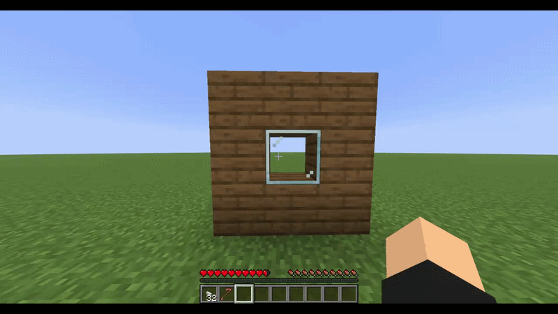
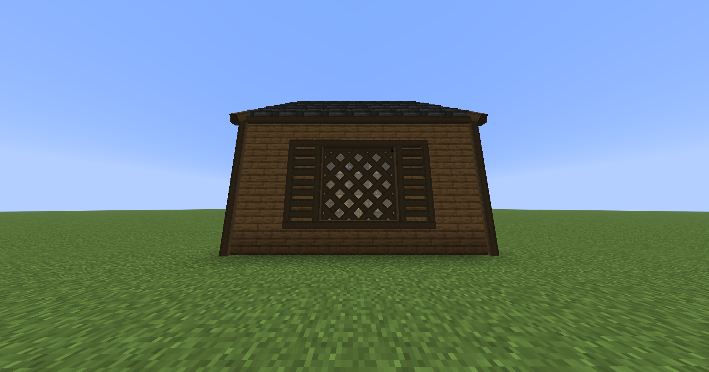
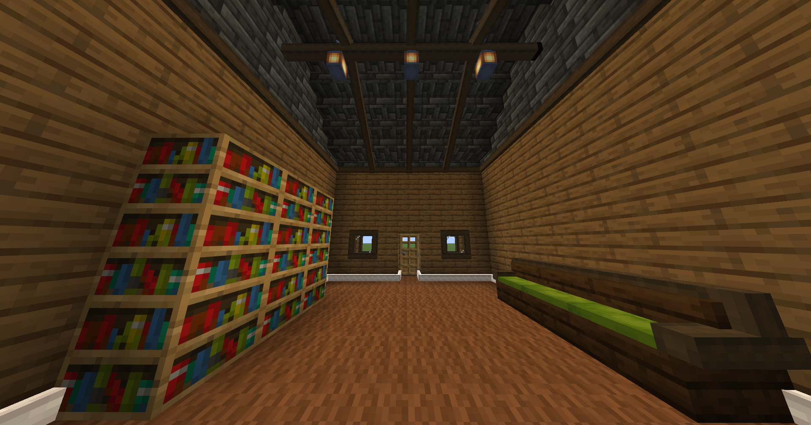
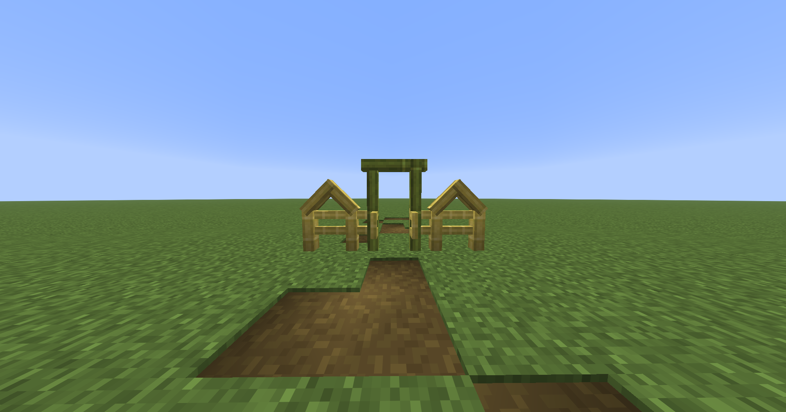
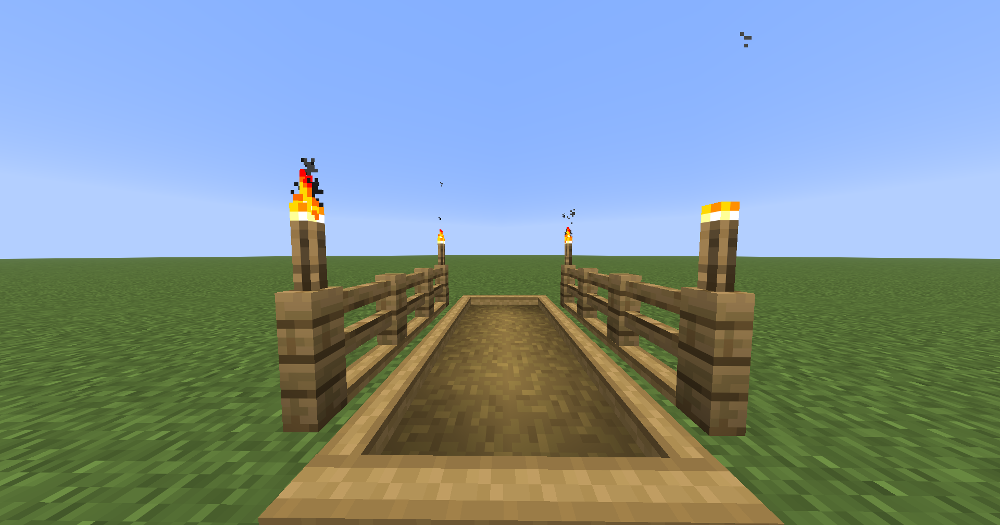
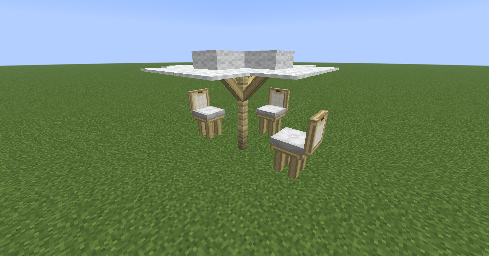

# Sensha Beams

Inspired by support beams in Vintage Story, Sensha Beams is a datapack that gives players more building freedom by placing beams spanning one point to another.  Players can also break beams using a crowbar.

# What Beams Are Available?

- Wooden Beams from every Stripped Log and Hyphae
- Wooden Beams for Bamboo Blocks and Stripped Bamboo Blocks
- (To be Implemented) Dyeable Wool Covered Wooden Beams
- (To be Implemented) Metal Beams
- (To be Implemented) Brick Trims
- (To be Implemented) Leaf Hedges

# Future Goals

- Add more Beams, Trims, and Hedges
    - Dyeable Wool Covered Wooden Beams
    - Metal Beams
        - Copper Beams actually oxidizing inversely proportional to amount of copper around it
    - Brick Trims
        - Lines of Bricks
        - Only considering for Bricks, Resin Bricks, Nether Bricks, and Red Nether Bricks
- Implement Recipes
    - Log/Hyphae or Stripped Log/Hyphae in Stonecutter -> 64 Wooden Beams
    - 1 Carpet + 4 Wooden Beams -> 4 Wool Covered Wooden Beams
    - 1 Metal Block -> 64 Metal Beams
    - 1 Brick Block -> 32 Brick Trims
    - 1 Leaf Block + 8 Wooden Beams -> 8 Leaf Hedges
    - 2 ingots + 1 stick -> crowbar
- Better raycasting
    - detect block shapes for more accurate beam placement in/against partial blocks
    - implement optimizations to query less beams when holding a crowbar
    - implement optimizations to do less entity selection queries
    - place beams 1/16 away from the block being placed against
- Damage crowbar on use (in survival) and break if need be 
- Add more crowbars

# Building Examples

